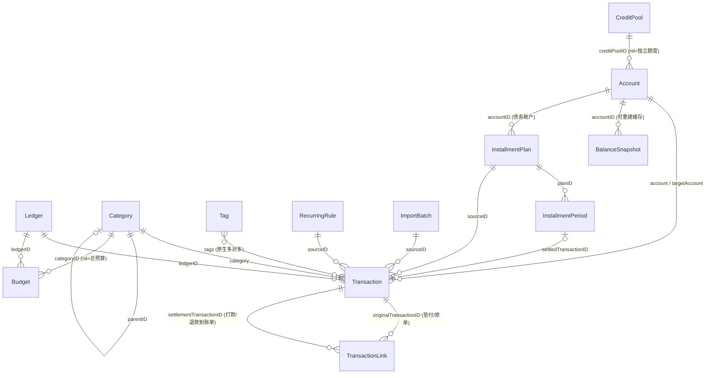

# 攒攒 新项目数据库设计文档（SwiftData · CloudKit）

## 1. 基本信息

| 项 | 值 |
| --- | --- |
| App | 攒攒——SwiftUI + SwiftData 记账应用（**全新项目**，与任何既往实现无关） |
| Bundle ID | 待定（新项目独立分配；CloudKit 容器全新创建，见 13.2） |
| 数据库引擎 | **SwiftData**（底层 Core Data / SQLite），CloudKit 同步兼容口径 |
| 数据库路径 | App 沙盒 `Library/Application Support/default.store` |
| 定位 | 以 iCost（业务语义覆盖）、钱迹（表拓扑简洁）两份逆向分析为参考的**绿地设计**；首个版本为 `SchemaV1`，当前版本为 `SchemaV2` |
| 表数量 | 15 张 |

> 本文档为设计基准（source of truth）：所有表/列/枚举一律按第 2 节命名规范执行。功能覆盖：多账本、多账户、两级分类、支出/收入/转账、标签、月度预算（含流水级豁免）、周期记账、CSV 导入（防重复）、报销（M:N——合并打款与多次到账）/退款、多币种（含跨币种转账）、信用卡（账单日/授信池）、消费分期/账单分期/贷款、余额校准/投资估值、归档停用、票据附件、记账位置、余额趋势、操作日志。文档更新于 2026-07-06。

## 2. 命名规范（全库强制）

| 规则 | 约定 | 示例 |
| --- | --- | --- |
| 实体名 | 单数名词；Swift 类名即实体名，不加前缀（`AppMeta` 除外，避免裸 `Meta` 含糊） | `Transaction` |
| 业务主键 | `uuid: UUID`（不可叫 `id`——`@Model` 的 Identifiable `id` 已被 `persistentModelID` 占用） | `uuid` |
| 外键（弱引用） | `<实体>ID: UUID`，一律 `ID` 后缀，禁用 `UUID` 后缀 | `ledgerID` / `categoryID` / `parentID` |
| 关系（对象引用） | 实体名小驼峰，语义角色作前缀 | `account` / `targetAccount` / `category` |
| 枚举列 | `<字段>RawValue: String` 落库 + 同名计算属性 `<字段>` 解析（视觉类失败带兜底值；语义类失败返 nil、严禁回写，见第 4 节前向兼容） ；rawValue **一律英文小驼峰**，禁用中文/本地化文案 | `kindRawValue` ↔ `kind` |
| 金额 | `<字段>MinorUnits: Int`（分单位） | `amountMinorUnits` |
| 利率 | `<字段>Bps: Int`（基点，1bp = 0.01%，避免浮点） | `annualRateBps` |
| 时间 | `<事件>At: Date`，无裸 `date`/`time` | `occurredAt` / `nextRunAt` |
| 布尔 | `is` / `has` / `can` 前缀，肯定语义（不用否定式） | `isBuiltIn`，而非 `notEditable` |
| 排序 | 统一 `sortOrder: Int` | — |
| 计数 | `<名词>Count` | `transactionCount` |
| 币种 | `currencyCode: String`（ISO 4217） | `"CNY"` |
| 图标 | 固定四件套 `iconKindRawValue` / `iconPrimary` / `iconSecondary` / `iconIndex` | — |
| 备注 | 统一 `note: String`（非可空，空为 `""`） | — |
| 来源包 | `sourceKindRawValue` + `sourceID` 成对出现 | 见 5.4 |

## 3. 全表清单

| # | 模型 | 域 | 用途 |
| --- | --- | --- | --- |
| 1 | `Ledger` | 核心 | 账本 |
| 2 | `Account` | 核心 | 资产/账户（含信用卡属性） |
| 3 | `Category` | 核心 | 收支分类（自引用两级树） |
| 4 | `Transaction` | 核心 | 流水主表（支出/收入/转账） |
| 5 | `TransactionLink` | 核心 | 流水关联（报销/退款分摊，M:N） |
| 6 | `Tag` | 核心 | 标签（原生多对多） |
| 7 | `Budget` | 核心 | 预算（模板行 + 按月实体行） |
| 8 | `CreditPool` | 负债 | 银行授信池（多卡共享额度） |
| 9 | `InstallmentPlan` | 负债 | 分期/贷款合同（消费分期、账单分期、贷款共用） |
| 10 | `InstallmentPeriod` | 负债 | 分期期数（一期一行，物化还款日程） |
| 11 | `RecurringRule` | 自动化 | 周期记账（规则 + 类型化模板） |
| 12 | `ImportBatch` | 自动化 | 导入批次（整批撤销） |
| 13 | `BalanceSnapshot` | 辅助 | 账户余额检查点（可重建缓存） |
| 14 | `AuditLog` | 辅助 | 操作日志（只追加，排障用） |
| 15 | `AppMeta` | 辅助 | 库级元数据（schema 版本标记，键值单例） |

刻意不建：标签分组、资产分组（按 `kind` 分组够用）、存钱计划、账本成员/多人协作、币种字典表（ISO 代码即字典，汇率快照落流水）、图片二进制列（附件存文件名引用，文件放沙盒）、交易对象/商家字段（`note` 兼职，两家参考 App 亦如此）。

## 4. 通用约定

- **通用基础字段**：所有表共享以下 4 个字段，第 5 节不再重复列出：

| 字段 | 类型 | 含义 |
| --- | --- | --- |
| `uuid` | UUID | 业务主键，表间弱引用一律指向它 |
| `isSoftDeleted` | Bool | 软删除标记；全库**无硬删除**，删除一律软删 + 可撤销 |
| `createdAt` | Date | 创建时间 |
| `updatedAt` | Date | 最后修改时间（由 `*Commands` 写路径维护） |

- **金额**：分单位 `Int`，正数，方向由 `kind` 决定；换算唯一入口 `MoneyAmount`，展示格式化唯一入口 `formatAmount(_:withSign:)`，全库不允许第二种实现。
- **无哨兵值**：不用 `-1`（钱迹之弊），也不许 `nil` 兼职"默认值"这类双重语义。`nil` 只允许表达真实的「无/不适用」：`Category.ledgerID == nil` = 全局分类、`Budget.categoryID == nil` = 总预算、`Budget.periodYear == nil` = 模板行。`Transaction.ledgerID` 语义上必填，schema 因 CloudKit 兼容声明可空，命令层保证非空，读到 `nil` 视为脏数据。
- **双形态引用**：对象关系用于图遍历（流水 → 账户/分类），热查询字段冗余 UUID 列进 `#Index`（SwiftData 谓词穿关系能力有限）。**被引用实体的 `uuid` 一律建非唯一 `#Index`**——外键解析与来源反查全是 `uuid ==` 等值查询，无索引即全表扫描（CloudKit 禁 `#Unique` 但允许非唯一索引）。
- **日历口径**：`occurredAt` 存绝对时刻；按天/按月分组一律用设备当前日历时区。
- **归档与软删分立**（账本/账户/分类/标签四实体带 `isArchived`）：归档 = **停用**——记账不可再选、新引用禁止，但历史流水、统计、余额、净资产**全部照常**，列表折叠到"已归档"区，可随时取消；软删 = **删除**——从一切视图隐藏（可撤销）。"用了三年的分类不再用了"走归档零成本；删除被阻断时命令层引导改用归档。
- **软删除语义（逐实体定死，防幽灵数据）**：

| 实体 | 删除规则 |
| --- | --- |
| 账本 | 有活跃流水时**阻断并引导归档**，坚持删除须先迁移；删除后其预算级联软删 |
| 账户 | 有活跃流水时**阻断并引导归档**，坚持删除须先转移流水；余额快照级联软删 |
| 分类 | 有活跃流水时**阻断并引导归档**，坚持删除须先转移；删父分类须先处理全部子分类 |
| 标签 | 直接软删，读路径 `.active` 过滤自然隐藏，恢复即回归 |
| 授信池 | 保留成员弱引用；读路径临时按独立额度，撤销后原样恢复（见 5.8） |
| 分期计划 | 级联软删期数行，已生成流水不动（见 5.9） |
| 报销/退款到账单 | 级联软删关联行，原单状态回退（见 5.5） |
| 周期规则 | 软删即停，产出流水不动 |
| 导入批次 | 软删批次 = 整批软删其流水（即"整批撤销"） |

撤销恢复按相反方向执行；级联软删的行随主实体一并恢复。

- **派生优先**：账户余额、预算已用额、净资产、授信占用、分期进度全部派生计算；任何快照表/冗余标记都只是**可整体重建的缓存**，删光重算结果必须逐分一致。
- **本位币锁定**：统计基准币固定为 `CNY`，`fxRateToBase` 恒为对本位币的汇率。变更本位币属破坏性操作（历史快照全部失义），MVP 禁止；未来放开须全量重算并记 `AuditLog`。
- **折算口径**（多币种统一规则）：① 收支统计/预算已用额——外币流水按**自身** `fxRateToBase` 快照折本位币（历史口径永固）；② 净资产/余额展示——按**该币种全库最近一笔流水的汇率快照**折算（"流水快照即汇率字典"，随记账自动更新，展示层标注汇率时点；该币种无任何快照时按 1:1 并醒目提示）；③ 预算金额本身一律以本位币计。
- **同步合并兜底**：一切"命令层唯一性/上限"不变量（默认账本唯一、分摊 ≤ 上限等）在 CloudKit 多设备离线合并下都可能短暂破坏——**读路径必须归一化兜底**（`LedgerSelection` 的默认账本归一化是标准样板），写路径发现违例时就地修复并记 `AuditLog`，绝不 crash、绝不静默算错。
- **不做名称快照**：全程软删除 + 对象引用，引用永不悬空；改名后历史流水显示新名是特性。唯一值得快照的是记账时汇率（见 5.4）。
- **SwiftData 铁律**：列默认值写在属性声明处（轻量迁移不走 `init`）；关系全可空、**全部显式声明 inverse**、全字段有默认值（均为 CloudKit 硬要求）；不用 `#Unique`（同上）；结构化小字段用 Codable 值类型（如 `[Int]` / `[String]`），禁 JSON 字符串列。schema 版本化与迁移流程见第 13 章。
- **查询下推（性能默认，非优化项）**：`isSoftDeleted` / `ledgerID` / `occurredAt` 窗口 / `kindRawValue` / 状态列等**本表标量过滤一律在 `FetchDescriptor` + `#Predicate` 层完成**，命中第 8 节复合索引；禁止先取全量再内存 filter。内存层只保留谓词表达不了的口径：关系穿越（分类 rollup、标签筛选）、跨行聚合（SwiftData 无 SUM，但聚合输入已被谓词收窄到账本 × 账期范围）。`ModelFiltering` 的 `.active` / `.within(_:)` 定位为**已取回集合的二次收窄工具**，不得作为主过滤路径。
- **前向兼容（版本偏斜防护）**：CloudKit 多设备允许新旧版本 App 并存，未知数据必须无害。① 枚举解析失败分两类——视觉类（图标/颜色）回落默认仅用于展示；语义类（`kind` / `sourceKind` / 各状态列）**保留原串、按「未知」处理**：相关数据从精确统计中剔除、置为只读并提示升级，**严禁回写兜底值覆盖原数据**（否则旧 App 会静默改坏新版本数据）。② schema 演进三律：字段只加不删不改类型；枚举 rawValue 只加值不改值；新列必带声明处默认值。删除/改名走「加新列、双写过渡、弃读旧列」。③ `AppMeta.schemaVersion` 记录本库被写入过的最高版本（值从第 13 章版本登记簿派生，不手维护），App 版本低于它即进入兼容模式（未知值只读、不回写）。
- **首启种子**：`DefaultDataSeeder` 幂等写入默认账本、默认账户、默认两级分类；种子分类打 `isBuiltIn = true`，供「恢复默认分类」识别。

---

## 5. 表结构详解

### 5.1 `Ledger` — 账本

| 字段 | 类型 | 默认 | 含义 |
| --- | --- | --- | --- |
| `name` | String | — | 账本名 |
| `isDefault` | Bool | false | 是否默认账本（有且仅有一本，命令层保证） |
| `iconKindRawValue` / `iconPrimary` / `iconSecondary` / `iconIndex` | String×3 + Int | `""`/`""`/`""`/0 | 图标四件套 |
| `colorID` | String | `"blue"` | 主题色 token |
| `isArchived` | Bool | false | 归档（切换器折叠，数据照常可看，见第 4 节归档语义） |
| `sortOrder` | Int | 0 | 账本切换器排序 |

### 5.2 `Account` — 资产/账户

| 字段 | 类型 | 默认 | 含义 |
| --- | --- | --- | --- |
| `name` | String | — | 账户名 |
| `subtitle` | String | `""` | 副标题（银行/渠道名） |
| `kindRawValue` | String | — | 账户大类（见第 6 节 `AccountKind`） |
| `iconKindRawValue` / `iconPrimary` / `iconSecondary` / `iconIndex` | String×3 + Int | — | 图标四件套 |
| `currencyCode` | String | `"CNY"` | 币种 |
| `initialBalanceMinorUnits` | Int | 0 | 期初余额；**当前余额 = 期初 + 流水派生，不落库** |
| `creditLimitMinorUnits` | Int? | nil | 信用额度（仅 credit 类）：独立卡 = 自身额度；池成员 = 可选**单卡子限额**（nil = 仅受池约束） |
| `creditPoolID` | UUID? | nil | → `CreditPool.uuid`；nil = 独立额度；仅 credit 类可设（命令层校验），见 5.8 |
| `statementDay` | Int? | nil | 账单日（1–28） |
| `paymentDueDay` | Int? | nil | 还款日（1–28） |
| `note` | String | `""` | 备注 |
| `isIncludedInNetWorth` | Bool | true | 是否计入净资产 |
| `isSelectableForRecord` | Bool | true | 记账时是否可选（活跃但不参与记账的精细控制，如公积金） |
| `isArchived` | Bool | false | 归档（停用：不可选 + 列表折叠；余额与统计照常，`isIncludedInNetWorth` 独立生效） |
| `sortOrder` | Int | 0 | 组内排序 |

信用卡属性摊平为类型化可空列，弃 iCost/钱迹 的 JSON 塞法。「本期账单金额 / 剩余免息天数」由投影器按 `statementDay` 切分流水派生，不落库。

**余额校准**（`investment` 账户成立的前提）：账户与现实对不上时（漏记零头、理财市值波动），命令层提供"校准到实际余额"——按差额自动生成一笔收支流水，`sourceKind = adjustment`、默认 `isExcludedFromStats = true`。投资市值更新即定期校准；余额始终由流水派生，原则不破。

### 5.3 `Category` — 收支分类

| 字段 | 类型 | 默认 | 含义 |
| --- | --- | --- | --- |
| `name` | String | — | 分类名 |
| `kindRawValue` | String | — | 方向：`expense` / `income` |
| `iconKindRawValue` / `iconPrimary` / `iconSecondary` / `iconIndex` | String×3 + Int | — | 图标四件套 |
| `sortOrder` | Int | — | 同层排序 |
| `parentID` | UUID? | nil | nil = 一级分类；否则指向父分类（两级树，命令层禁止三级） |
| `ledgerID` | UUID? | nil | nil = 全局分类；非 nil = 账本专属分类 |
| `isBuiltIn` | Bool | false | 系统预置（seed 注入；「恢复默认分类」按此识别） |
| `isArchived` | Bool | false | 归档（记账不可选，历史统计照常）；归档父分类连带子分类不可选 |

**统计 rollup 口径**：流水可挂一级或二级分类；统计时二级金额汇入其父类，「父类直挂」与「子类汇总」并列展示。

### 5.4 `Transaction` — 流水（主表）

复合索引：`#Index([\.isSoftDeleted, \.ledgerID, \.occurredAt])`（等值列在前、排序列在后，匹配页面主查询 `WHERE isSoftDeleted = 0 AND ledgerID = ? ORDER BY occurredAt DESC`）。

| 字段 | 类型 | 默认 | 含义 |
| --- | --- | --- | --- |
| **核心** | | | |
| `kindRawValue` | String | — | `expense` / `income` / `transfer`；**终生不可改写**（修 iCost 报销陷阱） |
| `amountMinorUnits` | Int | — | 金额（分，正数） |
| `occurredAt` | Date | — | 业务发生时间（可回填补记） |
| `note` | String | `""` | 备注 |
| `ledgerID` | UUID? | — | → `Ledger.uuid`（命令层保证非空） |
| `account` | Account? | — | 收支账户；转账时为转出方 |
| `targetAccount` | Account? | nil | 转账转入方（非转账为 nil） |
| `category` | Category? | — | 收支分类（转账为 nil） |
| `tags` | [Tag]? | nil | 标签（原生多对多，修钱迹逗号串之弊） |
| `attachmentFileNames` | [String] | `[]` | 附件（票据照片等）文件名，文件存沙盒 `Attachments/`，不入库（不随 CloudKit 库同步，需另走文件同步）。软删流水保留附件（撤销需要），彻底清理由维护命令连带删文件，杜绝孤儿 |
| `locationName` | String | `""` | 记账位置 POI 名（空 = 未记录） |
| `locationLatitude` / `locationLongitude` | Double? | nil | 位置经纬度（与 `locationName` 同记同空；采 iCost 三字段思路，弃其 `纬度,经度` 拼串） |
| **统计口径开关** | | | |
| `isExcludedFromBudget` | Bool | false | 该笔不计入预算已用额（iCost `isNoCountBudget` 对应物） |
| `isExcludedFromStats` | Bool | false | 该笔不计入收支统计（代付/走账场景）；**余额永远照算**——不存在流水级"不计入资产"豁免，否则派生余额失真 |
| **多币种** | | | |
| `currencyCode` | String | `"CNY"` | 记账币种（收支 = 账户币种；转账 = 转出方币种） |
| `targetAmountMinorUnits` | Int? | nil | **跨币种转账**的转入方到账金额（转入账户币种计）；同币种为 nil |
| `fxRateToBase` | Decimal? | nil | 记账时对本位币（CNY）汇率快照（采 iCost 思路，收敛为单值；事后汇率变动不影响历史）。**必填规则**：`currencyCode ≠ CNY` 时命令层强制非空（记账页预填最近快照，可改），本位币流水恒 nil |
| `feeMinorUnits` | Int | 0 | 转账手续费/分期利息（计入支出统计）。**余额口径**：转出方 delta = −(amount + fee)，转入方 = +(targetAmount ?? amount) |
| **来源包**（钱迹 `packid` 泛化） | | | |
| `sourceKindRawValue` | String | `"manual"` | 来源：`manual` / `csvImport` / `recurring` / `voice` / `installment` / `adjustment`（余额校准，见 5.2） |
| `sourceID` | UUID? | nil | → `ImportBatch` / `RecurringRule` / `InstallmentPlan` 的 `uuid` |
| **报销/退款**（经 `TransactionLink` 关联，见 5.5） | | | |
| `reimbursementStatusRawValue` | String | `""` | `""` / `waiting` / `settled`（仅垫付支出单持有）；「部分报销中」为派生态 = waiting 且已报销额 > 0，不落库 |
| `settlementKindRawValue` | String | `""` | `""` / `reimbursement` / `refund`（仅到账单持有）：命令层与关联行同步维护的**冗余身份标记**，免除列表徽标/统计剔除逐行 join 关联表；可由关联表全量重算 |

模型自带派生（勿在页面重算）：`signedMinorUnits`（支出负/收入正/转账 0）、`balanceDeltaMinorUnits(for:)`（对指定账户的余额影响，含 fee 口径）。

命令层基础校验：`category.kind` 必须等于流水 `kind`（支出单不得挂收入分类）；转账 `targetAccount ≠ account`（禁自转）；收支必有 `account`，转账必有双方账户。

**报销流程**：垫付时支出单照常记 `expense`，置 `reimbursementStatus = waiting`（"待报销"列表按此谓词查询）；打款到账时另立一条 `income`，为其覆盖的每张垫付单各建一条 `TransactionLink`（带分摊金额）。原支出单 `kind` 终生保持 `expense`——「已报销支出是否剔除」由投影器决定，建模层不改写类型（修 iCost 原地改写陷阱）。合并打款（N 垫付 : 1 到账）、多次报销（1 垫付 : N 到账）、部分报销（Σ 分摊 < 垫付额）由同一机制统一表达。退款同表 `kind = refund`。**统计口径**：`settlementKind == reimbursement` 的入账默认不计收入（它是费用冲减，计入会虚增收入）；退款入账在统计中冲减对应分类支出——均由投影器执行。

### 5.5 `TransactionLink` — 流水关联（报销/退款分摊）

报销的真实多重度是 **M:N**：一次打款可并报多张垫付单，一张垫付单也可分多次到账（垫付 1 万，先报 6 千再报 4 千）。单列指针无论放在哪一侧都会砍掉一半场景，故建关联表：**一行 = 一次分摊**。

| 字段 | 类型 | 默认 | 含义 |
| --- | --- | --- | --- |
| `originalTransactionID` | UUID | — | → 原单（报销 = 垫付支出单；退款 = 原支出单） |
| `settlementTransactionID` | UUID | — | → 到账单（报销打款/退款入账，`kind` 均为 `income`） |
| `kindRawValue` | String | — | `reimbursement` / `refund` |
| `amountMinorUnits` | Int | — | 本次分摊金额（分），**以原单币种计**（报销进度只对原单有意义） |

**派生值（不落库）**：原单已报销/已退款额 = Σ 其关联行金额；到账单已分配额 = Σ 其关联行金额。**跨币种报销**（垫付外币、本位币到账）时"Σ 分摊 ≤ 到账金额"的校验按各自 `fxRateToBase` 折本位币后近似比较（容差为具名常量，初始 1%，随真实数据校准），原单侧校验不受影响。实际到账额就是 `income` 流水本身的金额，无需 iCost 的 `realClaimPrice` 冗余字段。

**命令层不变量**（并入 `TransactionService`）：

- 单张原单的 Σ 分摊 ≤ 原单金额；单笔到账单的 Σ 分摊 ≤ 到账金额。
- **编辑金额联动**：原单/到账单金额被改小到低于既有 Σ 分摊时，命令层阻断，要求先调整分摊行。
- 打款到账时按选中垫付单顺序自动分摊，允许手调。
- 原单被全额覆盖 → 自动置 `settled`；实报少于垫付时用户可手动结案置 `settled`。
- 软删到账单/关联行 → 级联软删关联行，重算受影响原单状态（`settled` → `waiting`）与到账单 `settlementKind` 标记。

索引：`#Index([\.originalTransactionID], [\.settlementTransactionID])`（两个方向的反查各一）。

### 5.6 `Tag` — 标签

| 字段 | 类型 | 默认 | 含义 |
| --- | --- | --- | --- |
| `name` | String | — | 标签名 |
| `colorID` | String | `"blue"` | 颜色 token（与账本同一套） |
| `sortOrder` | Int | 0 | 排序 |
| `ledgerID` | UUID? | nil | nil = 全局标签 |
| `isArchived` | Bool | false | 归档（不可再挂新流水，既有引用与统计照常） |

与 `Transaction.tags` 构成原生多对多（`@Relationship` 声明 inverse）。命令层校验：流水只能挂**全局标签或与流水同账本**的标签。

### 5.7 `Budget` — 预算（模板行 + 按月实体行）

| 字段 | 类型 | 默认 | 含义 |
| --- | --- | --- | --- |
| `ledgerID` | UUID | — | 所属账本（预算必挂账本） |
| `categoryID` | UUID? | nil | nil = 总预算；非 nil → 支出侧父分类 |
| `periodYear` | Int? | nil | nil = 模板行（对未来月份生效的默认额） |
| `periodMonth` | Int? | nil | 与 `periodYear` 同空同有 |
| `amountMinorUnits` | Int | — | 预算额度 |

- 查询：`(periodYear, periodMonth)` 实体行 → 无则回落模板行。
- 改「本月预算」→ 物化当月实体行；改「默认预算」→ 改模板行，已物化的历史月份不受影响——历史口径永不被篡改。
- 已用额由投影器按当月流水实时汇总（剔除 `isExcludedFromBudget` 与已报销支出；外币支出按流水汇率快照折本位币），不落库。预算金额以本位币计。
- 周期仅月度：年/周预算属产品裁决不做，非结构限制。

### 5.8 `CreditPool` — 银行授信池

同一家银行给出总授信、名下多张信用卡/信用产品共享占用的建模。两家参考 App 均无真实实现（钱迹只有名为「信用卡授信」的展示分组，iCost 只有单卡 `debtLimit`），本表为攒攒原创设计。

| 字段 | 类型 | 默认 | 含义 |
| --- | --- | --- | --- |
| `name` | String | — | 池名（通常为银行名，如「招商银行」） |
| `totalLimitMinorUnits` | Int | — | 总授信额度（分） |
| `currencyCode` | String | `"CNY"` | 币种（成员账户币种须与池一致，命令层校验） |
| `iconKindRawValue` / `iconPrimary` / `iconSecondary` / `iconIndex` | String×3 + Int | `""`/`""`/`""`/0 | 图标四件套（通常取银行类素材） |
| `note` | String | `""` | 备注 |
| `sortOrder` | Int | 0 | 资产页池间排序 |

成员关系由 `Account.creditPoolID` 反向表达（一池多卡、一卡至多一池），池表自身不存成员列表。

**额度全部派生、不落库**（由 `AssetProvider` 扩展计算）：

- 单卡欠款 = `max(0, −派生余额)`（信用账户欠款时派生余额为负）
- 池已用 = Σ 活跃成员卡的单卡欠款——**溢缴款不释放池额度**（某卡还多了不增加其他卡可用）
- 池可用 = `max(0, totalLimitMinorUnits − 池已用)`
- 单卡可用 = 有子限额时 `min(子限额 − 单卡欠款, 池可用)`；无子限额时即池可用

**命令层不变量**（`CreditPoolDraft` / `CreditPoolCommands`）：

- `creditPoolID` 只允许设在 `kind == credit` 的账户上；账户改类型时自动解绑。
- 软删池 → 成员卡 `creditPoolID` 保留；读路径忽略软删池并临时按独立额度展示，撤销后成员关系原样恢复。显式解绑仍由用户单独执行。
- 池行数极少，不建索引。

### 5.9 `InstallmentPlan` — 分期/贷款合同

消费分期、账单分期、贷款三类共用的**债务合同**实体，`kind` 区分。与流水的分工原则：**余额记录已发生的事实，计划记录未来的义务**——欠款真相始终在账户派生余额里，本表只负责日程、利息拆分与进度。

| 字段 | 类型 | 默认 | 含义 |
| --- | --- | --- | --- |
| `name` | String | — | 计划名（如「iPhone 24 期」「房贷」） |
| `kindRawValue` | String | — | `purchase`（消费分期）/ `statement`（账单分期）/ `loan`（贷款） |
| `accountID` | UUID | — | 债务账户：分期 → `credit` 账户；贷款 → `payable` 账户（命令层校验匹配） |
| `ledgerID` | UUID | — | 产出还款流水的归属账本 |
| `principalMinorUnits` | Int | — | 本金总额（分） |
| `totalPeriods` | Int | — | 总期数 |
| `annualRateBps` | Int? | nil | 年利率（基点）；固定手续费类分期为 nil |
| `amortizationKindRawValue` | String | — | 还款方式：`annuity` / `linearPrincipal` / `interestOnly` / `flatFee` / `custom`（见 5.10 生成规则） |
| `totalChargeMinorUnits` | Int? | nil | 固定息费总额；旧计划与按利率计算的计划为 nil，已物化期表仍是唯一真相 |
| `chargeCollectionKindRawValue` | String | `"perPeriod"` | `perPeriod`（分期收取）/ `upfrontFirstPeriod`（首期一次收取） |
| `principalRoundingKindRawValue` | String | `"downToMinorUnit"` | 本金取整规则：向下到最小单位 / 四舍五入到最小单位 / 四舍五入到主要货币单位 |
| `principalRemainderKindRawValue` | String | `"lastPeriod"` | 本金尾差归 `firstPeriod` / `lastPeriod` |
| `chargeRoundingKindRawValue` | String | `"downToMinorUnit"` | 息费取整规则，取值同本金取整 |
| `chargeRemainderKindRawValue` | String | `"lastPeriod"` | 息费尾差归 `firstPeriod` / `lastPeriod` |
| `firstDueAt` | Date | — | 首期还款日 |
| `isAutoSettle` | Bool | false | **保留字段，当前版本必须为 false**；自动提醒/自动生成还款流水均为后续能力 |
| `statusRawValue` | String | `"active"` | `active` / `completed` / `settledEarly` |
| `closedAt` | Date? | nil | 完结/提前结清时间 |
| `note` | String | `""` | 备注 |

**派生值（不落库）**：已还期数 = 期表 `settled` 行数；剩余本金 = Σ `pending` 期本金；应付总利息 = Σ 全期利息。**未到期利息不计入负债**（负债只认账户余额，权责发生制口径）。

**三类场景的记账形态**：

- 消费分期：购物流水照常记 `expense` 挂信用卡（欠款即时进余额，授信池占用自动成立），本表只接管**还款侧**日程。
- 账单分期：卡上已有欠款，直接建计划拆期，无需任何"转换"流水。
- 贷款：建 `payable` 账户（期初 0），放款记 `transfer`（应付 → 资金，账户余额变 −本金），还款按期表执行。

**当前实现边界**：当前版本仅支持用户手工确认后生成还款流水，尚未实现到期提醒、自动结算、逐期改期/减免或浮动利率重定价。`InstallmentPlanDraft` 与既有计划写命令均拒绝 `isAutoSettle == true`，避免保留字段造成虚假自动化承诺。

**命令层不变量**（`InstallmentPlanDraft` / `InstallmentPlanCommands`）：

- 创建计划 → 按 `amortizationKind` 一次性生成全部期数行；固定息费方式使用计划保存的取整/尾差规则，其他方式按 5.10 的固定生成规则计算；本金与固定息费总额分别逐最小单位守恒。
- 银行预设只在表单内填充上述显式计算规则，不保存银行名、不填费率或息费金额；表单只读展示具体产品范围与官网来源，保存前允许逐项覆盖。
- 所有既有计划写命令先校验计划/期状态及收取、取整、尾差语义，并验证期序完整唯一与本金守恒；未知或损坏数据只读，禁止绕过后继续写入。
- 每期还款 → 生成**一笔** `transfer`（资金账户 → 债务账户，`amount` = 该期本金，`fee` = 该期利息/手续费），打 `sourceKind = installment, sourceID = plan.uuid`；期行置 `settled` 并回填 `settledTransactionID`。按 5.4 的 fee 余额口径，资金账户减少月供全额、债务账户只回补本金——利息自然沉淀为支出，会计上恰好正确。
- 正常还款只允许偿还最早待还期，正常撤销只允许撤销最近已还期；避免首期一次息费被跳过。
- 提前结清 → 剩余 `pending` 期置 `cancelled`，生成一笔结清转账（amount = 剩余本金，fee = 结清违约金 + 尚未支付的首期一次息费），计划置 `settledEarly`。
- 软删计划 → 级联软删期数行；**已生成的流水不动**（历史事实）。
- **后续能力（当前未实现）—利率重定价**（LPR 年调等浮动利率场景）：计划中的命令层"变更利率"操作应保持 `settled` / `cancelled` 期不可变，仅对 `pending` 期自生效日按新利率重算本息拆分；届时更新 `annualRateBps`、追加 `AuditLog`，覆盖既有手改值前要求用户确认。
- 计划自带期表即日程，**不依赖** `RecurringRule`（那是无本金概念的重复模板流水）。

### 5.10 `InstallmentPeriod` — 分期期数

一期一行，建计划时全量物化。房贷 360 期也只有 360 行，SQLite 无压力，并为后续逐期改期/减免提供可谓词查询的数据基础；**当前版本尚未提供单期修改命令与 UI**。这是拒绝 iCost `loanPerMonthPrices` JSON 数组的直接理由。

| 字段 | 类型 | 默认 | 含义 |
| --- | --- | --- | --- |
| `planID` | UUID | — | → `InstallmentPlan.uuid` |
| `periodIndex` | Int | — | 期序（1 起） |
| `dueAt` | Date | — | 应还日 |
| `principalMinorUnits` | Int | — | 该期本金 |
| `interestMinorUnits` | Int | — | 该期利息/手续费 |
| `statusRawValue` | String | `"pending"` | `pending` / `settled` / `cancelled`（提前结清时未到期部分） |
| `settledAt` | Date? | nil | 实还时间 |
| `settledTransactionID` | UUID? | nil | → 该期还款转账流水 |

**各还款方式的期表生成规则**（命令层实现，期表行是唯一真相，`amortizationKind` 仅作再生成/展示元数据）：

| 方式 | 每期本金 | 每期利息/手续费 |
| --- | --- | --- |
| `annuity` 等额本息 | 月供 − 当期利息（月供 = P·r(1+r)ⁿ / ((1+r)ⁿ−1)） | 剩余本金 × 月利率 |
| `linearPrincipal` 等额本金 | P / n | 剩余本金 × 月利率 |
| `interestOnly` 先息后本 | 前 n−1 期 0，末期 P | P × 月利率 |
| `flatFee` 固定手续费 | 按本金取整/尾差规则分配 | 息费总额按收取、取整与尾差规则分配 |
| `custom` 自定义 | 新建计划时由用户逐期录入 | 同左；建成后的逐期修改为后续能力 |

索引：`#Index([\.planID, \.periodIndex])`。

### 5.11 `RecurringRule` — 周期记账

避开 iCost 56 字段巨表与钱迹不可查询的 JSON blob：规则字段 + 类型化模板字段，一表约 15 列。

| 字段 | 类型 | 默认 | 含义 |
| --- | --- | --- | --- |
| **规则** | | | |
| `name` | String | — | 计划名 |
| `frequencyRawValue` | String | — | `daily` / `weekly` / `monthly` |
| `interval` | Int | 1 | 间隔（每 n 天/周/月） |
| `recurrenceDays` | [Int] | `[]` | 周内/月内触发日（Codable 数组，非 JSON 字符串）；值大于当月天数时**取月末**（31 号规则在 2 月于 28/29 日触发） |
| `startAt` | Date | — | 生效起点 |
| `endAt` | Date? | nil | 截止（nil = 无限期） |
| `nextRunAt` | Date | — | 下次生成时间 |
| `isPaused` | Bool | false | 暂停 |
| **模板**（`TransactionDraft` 的持久化子集） | | | |
| `templateKindRawValue` | String | — | 生成流水的类型 |
| `templateLedgerID` | UUID? | nil | 生成流水的归属账本（命令层保证非空，与 5.4 `ledgerID` 同口径） |
| `templateAmountMinorUnits` | Int | — | 金额 |
| `templateAccountID` | UUID? | nil | 账户（转账时为转出方） |
| `templateTargetAccountID` | UUID? | nil | 转账转入方（`templateKind == transfer` 时必填，否则 nil） |
| `templateCategoryID` | UUID? | nil | 分类 |
| `templateTagIDs` | [UUID] | `[]` | 预设标签（房租/工资等周期账常配固定标签） |
| `templateNote` | String | `""` | 备注 |

生成的流水打 `sourceKind = recurring, sourceID = rule.uuid`；规则详情页反查产出、支持整体停用。

### 5.12 `ImportBatch` — 导入批次

| 字段 | 类型 | 默认 | 含义 |
| --- | --- | --- | --- |
| `fileName` | String | — | 源文件名 |
| `contentHash` | String | `""` | 源文件内容哈希（SHA-256）；命令层撞哈希时警告"疑似重复导入"，防同一文件导两次流水翻倍 |
| `transactionCount` | Int | 0 | 导入流水数 |
| `importedAt` | Date | — | 导入时间 |

流水打 `sourceKind = csvImport, sourceID = batch.uuid` → 误导入按批次反查、一键整批软删（采 iCost `pkeys` 思路，弃其 JSON 列表，直接反向查询）。恢复批次只复活与批次共享删除时间戳的流水，批次撤销前已逐笔删除的流水保持删除。

### 5.13 `BalanceSnapshot` — 余额检查点

钱迹 `asset_snapshot`（趋势历史）× 攒攒派生余额（正确性）＝**带检查点的派生**。

| 字段 | 类型 | 默认 | 含义 |
| --- | --- | --- | --- |
| `accountID` | UUID | — | → `Account.uuid` |
| `snapshotAt` | Date | — | 快照时点（如每月末落一条） |
| `balanceMinorUnits` | Int | — | 该时点派生余额的物化（账户币种计） |
| `fxRateToBase` | Decimal? | nil | 快照时点该币种对本位币汇率（取当时最近流水快照；CNY 账户为 nil）——外币净资产**历史**趋势必须按当时汇率折算，用今天的汇率折去年的余额是错的 |

索引：`#Index([\.accountID, \.snapshotAt])`。

- 用途一：净资产趋势图不再全量回算历史流水。
- 用途二：当前余额 = 最近快照 + 之后流水增量，账龄多年后仍 O(近期)。
- **失效规则**（快照正确性的前提是"时点之前的流水没变过"）：对某账户写入/编辑/软删/恢复任何 `occurredAt ≤ 该账户最新快照时点` 的流水时，命令层级联软删该账户此时点及之后的全部快照，由重建命令惰性补建——**宁可少快照，不可留脏快照**。
- 铁律：**只是缓存**。重建入口做成一个命令，「全删重算逐分一致」由测试固化。

### 5.14 `AuditLog` — 操作日志

| 字段 | 类型 | 默认 | 含义 |
| --- | --- | --- | --- |
| `action` | String | — | 操作类型（如 `accountDelete`） |
| `detail` | String | `""` | 详情 |
| `occurredAt` | Date | — | 时间 |

只追加不更新，供排障与"我的数据怎么变的"审计（采钱迹 `user_log`）。滚动保留（如 180 天），由维护命令清理，防无限增长。

### 5.15 `AppMeta` — 库级元数据（键值单例）

| 字段 | 类型 | 默认 | 含义 |
| --- | --- | --- | --- |
| `key` | String | — | 键（如 `schemaVersion`） |
| `value` | String | `""` | 值 |

采钱迹 `key_value` 思路但**用途锁死为系统标记**，业务数据禁入（防 KV 垃圾场）。当前唯一键：

- `schemaVersion`：本库被任何设备写入过的**最高** schema 版本，值从第 13 章 `VersionedSchema` 登记簿末位派生（不手维护）。每次写库前比对：App 版本 ≥ 标记 → 正常（更高则更新标记）；App 版本 < 标记 → **兼容模式**——未知枚举值/未知列只读不回写、语义未知数据从精确统计剔除、提示升级。全量备份格式（见第 11 节）复用此版本号。
- `dataMigration.<名称>`：命令层数据迁移的完成标记（见 13.3）。

---

## 6. 关键枚举（rawValue 一律英文小驼峰）

| 枚举 | 取值 |
| --- | --- |
| `TransactionKind` | `expense` / `income` / `transfer` |
| `AccountKind` | `fund`（资金）/ `credit`（信用）/ `prepaid`（充值）/ `investment`（理财）/ `receivable`（应收）/ `payable`（应付） |
| `TransactionSourceKind` | `manual` / `csvImport` / `recurring` / `voice` / `installment` / `adjustment` |
| `TransactionLinkKind` | `reimbursement` / `refund`（`TransactionLink.kind`；到账单冗余标记 `settlementKindRawValue` 复用本枚举，空串 = 非到账单） |
| `ReimbursementStatus` | `waiting` / `settled`（空串 = 非报销） |
| `RecurrenceFrequency` | `daily` / `weekly` / `monthly` |
| `InstallmentPlanKind` | `purchase` / `statement` / `loan` |
| `AmortizationKind` | `annuity` / `linearPrincipal` / `interestOnly` / `flatFee` / `custom` |
| `ChargeCollectionKind` | `perPeriod` / `upfrontFirstPeriod` |
| `InstallmentRoundingKind` | `downToMinorUnit` / `nearestMinorUnit` / `nearestMajorUnit` |
| `InstallmentRemainderKind` | `firstPeriod` / `lastPeriod` |
| `InstallmentPlanStatus` | `active` / `completed` / `settledEarly` |
| `InstallmentPeriodStatus` | `pending` / `settled` / `cancelled` |
| `IconDescriptor.Kind` | `symbol`（SF Symbol，primary = systemName）/ `asset`（内置素材，primary = 素材组、secondary = 素材名、index 备用序号）/ `emoji`（primary = emoji 字符）——按能力而非素材目录定义，素材库重组不影响 schema |

## 7. 实体关系图



## 8. 索引设计

| 模型 | 索引 | 服务的查询 |
| --- | --- | --- |
| `Transaction` | `(isSoftDeleted, ledgerID, occurredAt)` | 账本页/统计页主查询 |
| `BalanceSnapshot` | `(accountID, snapshotAt)` | 趋势图取数、最近检查点定位 |
| `InstallmentPeriod` | `(planID, periodIndex)` | 计划详情期表；「近期待还」提醒需要时再补 `dueAt` 索引 |
| `TransactionLink` | `(originalTransactionID)`、`(settlementTransactionID)` | 原单查报销进度、到账单查分摊明细（双向反查各一） |
| 各被反查实体 | `(uuid)` 非唯一 | 外键解析与来源反查（`ledgerID` / `sourceID` / `settledTransactionID` / `parentID` 等）全是 `uuid ==` 等值查询；至少覆盖 Transaction / Account / Category / Ledger / Tag / CreditPool / InstallmentPlan |

原则：查询形态驱动、按需追加（如流水 `sourceID` 待批量撤销/计划详情页高频后再补），不预建。

## 9. 数据访问分层

生产路径不直接读写 SwiftData 对象：

- **读**：`*Provider`（Ledger/Asset/Stats/Budget/Credit/Installment）把持久化模型投影为页面展示模型。取数必须走**谓词下推**（见第 4 节约定）：`FetchDescriptor` 承载软删/账本/账期/类型过滤并命中复合索引，`LedgerScope` / `ProjectionReadScope` 负责生成谓词而非内存过滤；`ModelFiltering` 的 `.active` / `.within(_:)` / `.totalMinorUnits(of:)` 仅用于已收窄集合的二次处理。
- **写**：表单输入 → `*Draft`（校验 + 归一化）→ `*Commands`（业务命令：插入/编辑/软删/撤销，维护 `updatedAt` 与本文档各表的命令层不变量）。
- **导入导出**：`TransactionCSVImporter` / `TransactionCSVExporter`，导入产出挂 `ImportBatch`。

**一致性与自愈（高可用三层防线）**：

1. **入口校验**：`*Draft` 拒绝非法输入（金额、日期、引用完整性），fail fast。
2. **命令不变量**：`*Commands` 维护本文档各表的命令层不变量（唯一性、上限、级联、冗余标记同步）。
3. **读路径归一化兜底**：投影器假定任何不变量都可能已被同步合并破坏，读到违例数据时归一化处理并可修复回写——绝不 crash、绝不静默算错。

可重建缓存与冗余（`BalanceSnapshot`、`settlementKindRawValue`）均可由流水/关联表**全量重算**，重建入口做成维护命令；「删光缓存后逐分一致」「随机打乱后自愈收敛」由测试固化。`reimbursementStatusRawValue` 还承载“实报不足时手动结案”的用户决定，不能仅凭关联金额无损重建，关联增删时由命令层同步维护。数据真相只有一份：流水 + 关联行 + 各实体本体，以及无法从关联行推导的显式用户决定。

## 10. 设计裁决记录

1. **余额坚持派生**：iCost/钱迹的冗余余额快照都在各自陷阱清单里（「直接写账单必须同步改余额」）——把缓存当真相的代价。派生 + 检查点两头兼得。
2. **报销用关联流水**：iCost 原地改写 `type` 使「统计支出不能只筛 type==0」，语义污染扩散到所有下游。关联流水让 `kind` 终生不变。
3. **周期记账与分期/贷款分表**：iCost 把周期规则 + 账单模板 + 自动分期揉成 56 字段巨表。本设计拆开——`RecurringRule` 管「无本金概念的重复模板流水」（房租/工资），`InstallmentPlan` 管「有本金/期数/利息日程的债务合同」，各约 15 列，互不依赖。
4. **不做名称快照列**：软删除 + 对象引用下引用永不悬空，快照要解决的问题在本架构不存在；少两列冗余，改名体验反而一致。
5. **不用 JSON 字符串列**：三家凡 JSON 列（iCost `categoryBudgets`、钱迹 `credit`/`loan`）都成了不可谓词查询、不可迁移校验的黑盒；Codable 值类型 + 可空列足够。
6. **业务主键叫 `uuid` 不叫 `id`**：`@Model` 的 Identifiable `id` 已被 `persistentModelID` 占用，这是 SwiftData 环境下的命名例外，全库统一。
7. **枚举列保留 `RawValue` 后缀**：与 Swift `RawRepresentable` 词汇一致，读写两侧（落库字符串 / 计算属性）命名可互推，不引入第二套缩写。
8. **授信池独立成表，而非资产分组**：钱迹的「信用卡授信」只是展示分组名，无共享额度语义；池带金额字段和派生规则，是业务实体不是归组容器——「刻意不建资产分组表」的裁决不受影响。池的已用/可用额度同样派生不落库，避免第 1 条批判过的「快照当真相」。
9. **溢缴款不释放池额度**：某卡还款超额（派生余额为正）时按欠款 0 计，不冲抵其他卡占用——与银行实际授信行为一致，也避免负欠款把「池已用」算成负数。
10. **期表用子表，不用数组/JSON**：iCost 的 `loanPerMonthPrices` 系列 JSON 数组不可谓词查询、不可单期修改。一期一行让未来的改期、减免与按月提醒具备普通行操作的数据基础；这些命令/UI 当前尚未实现。360 期的房贷也只是 360 行。
11. **一期还款只生成一笔转账**：`amount` = 本金、`fee` = 利息，配合「转出方 −(amount+fee)」的余额口径，资金账户扣月供全额、债务账户只回补本金、利息沉淀为支出——一笔流水同时把三个账算对。备选的「转账 + 利息支出两笔」方案会让每期产生两条需要保持一致的记录，放弃。代价是利息在分类统计中无归属，由投影器按 `fee` 汇总为「利息手续费」口径。
12. **余额 = 已发生，计划 = 未来义务**：欠款真相永远在账户派生余额（购物/放款流水即时入账），`InstallmentPlan` 不冗余任何"剩余应还"快照，未到期利息不计入负债。删光全部计划，净资产分毫不变。
13. **报销/退款用关联表，不用指针**：报销的真实多重度是 M:N——一次打款并报多张垫付单，同时一张垫付单可分多次到账。单列指针无论放哪侧都砍掉一半场景（本设计早期版本即踩此坑），`[UUID]` 数组又受 SwiftData contains 谓词限制。`TransactionLink` 一行一次分摊，合并打款、多次报销、部分报销共用同一机制，分摊金额落在关联行上，原单/到账单双侧进度皆可派生。
14. **统计口径豁免到流水、余额豁免只到账户**：`isExcludedFromBudget` / `isExcludedFromStats` 是投影口径开关，不触碰余额；"不计入资产"只允许在账户级（`isIncludedInNetWorth`）——若允许单笔流水豁免余额，派生余额与真实账户即刻失真，等于亲手重造 iCost/钱迹 的"余额对不上账"问题。
15. **到账单身份用冗余标记，不用逐行 join**：流水列表徽标和收入统计剔除是高频路径，逐行反查关联表代价不可接受。`settlementKindRawValue` 是命令层维护、可由关联表全量重算的展示缓存——不违反"不做名称快照"裁决（第 4 条防的是改名语义漂移，本条防的是 join 成本，且可自愈重建）。
16. **本位币锁定而非可配置**：`fxRateToBase` 快照的语义锚点是本位币；若本位币可随时更改，全部历史快照瞬间失义，等于把"事后汇率变动不影响历史"的设计目标亲手废掉。锁定 CNY，变更即破坏性操作。
17. **流水快照即汇率字典**：不建币种/汇率表（钱迹 `currency3` 155 行大多终生用不上），也不给账户加"当前汇率"列（同币种多账户会各存一份、互相打架）。"该币种最近一笔流水的快照"就是当前汇率——零新列、单一来源、随记账自动更新；代价是长期不记外币账时汇率过期，由展示层标注汇率时点缓解。
18. **投资市值用校准流水，不用直改余额**：余额是派生值，没有"直接改"的入口；市值波动通过 `adjustment` 来源的差额流水表达，默认不计收支统计。好处：市值变化有完整历史轨迹（何时、变了多少），趋势图免费获得；直改余额则历史全丢。
19. **归档与软删是两个字段，不是一个状态机**：「不再使用」（归档：停用但统计照常）和「不想看见」（软删：全部隐藏）是两个独立的用户意图，iCost/钱迹 均双字段并存验证过。合成一个 `statusRawValue` 状态机反而复杂：每个查询都要枚举合法状态集，两个正交 Bool 各自过滤更简单，也让"归档后再删除""恢复即回归档态"这类组合免费成立。
20. **查询下推是设计默认，不是将来的优化**：十年档案户的统计页性能不该靠"届时改造"兑现——复合索引与谓词形态在第 8 节按同一查询设计，下推是让索引真正被使用的另一半。内存过滤只保留给谓词表达不了的口径，且输入集必须已被谓词收窄。
21. **一张 `AppMeta` 换版本偏斜安全**：CloudKit 无法阻止旧 App 写入被新版本升级过的库，"演进纪律"写在文档里没有强制力；版本标记 + 未知值只读才是可执行的防线。代价是一张两列表，且用途锁死为系统标记（钱迹 `key_value` 沦为杂物间的教训）。官方 `VersionedSchema` 只管单机库迁移、不管多设备数据偏斜，两者互补（见第 13 章）。
22. **版本登记簿用官方机制、数据变换不用**：`VersionedSchema` 登记簿提供编译期版本历史与可测试的迁移路径，照用；`.custom` stage 在多设备同步下每台设备独立变换再互相同步，是重复变换与合并冲突之源，以幂等命令迁移（13.3）替代——各取官方机制在 CloudKit 约束下仍然成立的那一半。

## 11. 全量备份/恢复与未来路线

- **全量备份格式（已实现）**：`.zanzanbackup` 是目录包；清单保存 14 张非 `AppMeta` 表、`schemaVersion`、格式版本与附件摘要，`Attachments/` 保存全部被流水引用的附件原文。`AppMeta` 不直接归档，恢复时按当前 App 版本重建系统标记。
- **恢复语义（已实现）**：恢复前先校验清单与附件完整性，并在临时数据库演练；随后自动保存恢复前安全备份，以单次事务精确替换当前全部业务数据并整体切换附件目录，**不是按 `uuid` merge/upsert**。恢复日志支持 App 启动时自动收敛附件切换中断。
- **CSV 边界**：CSV 只用于普通流水交换，会跳过或丢失标签、附件及部分自动化语义，不能替代 `.zanzanbackup` 完整备份。
- **语音/OCR 识别日志表**（钱迹 `ocr_auto_bill_log4` 对应物）：`voice` 来源已入枚举，做"识别纠错/复核"功能时补日志表，属纯新增，零迁移。
- **汇率 API 自动刷新**：写入路径已就绪（记账页预填 `fxRateToBase`），接 API 零 schema 改动。
- **年/周预算、存钱计划、家庭共享/多人账本、商家维度统计**：见第 3 节"刻意不建"清单，立项再动。
- **`feeCategoryID`**：利息/手续费要自定义分类归属时加（现由投影器固定归"利息手续费"口径，见裁决 11）。

## 12. 实现风险提示

写给实现阶段的自己——这些不是 schema 缺陷，是本设计的结构性代价，实现时必须正视：

1. **复杂度在 Commands 层，不在表**。全库几十条不变量没有一条由数据库强制（SwiftData 无 CHECK/触发器，CloudKit 禁唯一约束），全靠命令层代码 + 读路径兜底。对策：每条不变量配一个测试；兜底逻辑（归一化、自愈重算）与命令逻辑同等对待，不是"防御性代码"而是设计的一半。
2. **聚合仍在内存**。谓词下推（第 4 节）解决了过滤，但 SwiftData 无 SUM/GROUP BY，汇总永远是取回后累加——守住"聚合输入必先被谓词收窄到账本 × 账期"这条线，性能就有界；破了这条线，下推形同虚设。
3. **能力全 ≠ 入口全**。15 张表支撑的功能全铺开就是会计软件。报销、分期、授信池、多币种都应是"用到才出现"的渐进披露，默认界面保持记一笔账三秒完成——表可以全，入口必须克制。

## 13. Schema 版本化与迁移手册（官方机制 × CloudKit）

前提：本库最终启用 iCloud（CloudKit）同步。官方 `VersionedSchema` + `SchemaMigrationPlan` 是版本化的正式机制，本章规定它在 CloudKit 约束下的用法——**登记簿照用、`.custom` 禁用**。

### 13.1 版本登记簿（`VersionedSchema`，全 lightweight）

每次 schema 变更登记一个新版本类型，迁移计划只允许 `.lightweight` 衔接：

```swift
enum SchemaV1: VersionedSchema {
    static let versionIdentifier = Schema.Version(1, 0, 0)
    static var models: [any PersistentModel.Type] {
        [Ledger.self, Account.self, /* …全部 15 张表 */]
    }
}

enum SchemaV2: VersionedSchema { /* 变更后的模型集，版本 2.0.0 */ }

enum ZanzanMigrationPlan: SchemaMigrationPlan {
    static var schemas: [any VersionedSchema.Type] { [SchemaV1.self, SchemaV2.self] }
    static var stages: [MigrationStage] {
        [.lightweight(fromVersion: SchemaV1.self, toVersion: SchemaV2.self)]
    }
}

// App 入口
let container = try ModelContainer(
    for: Schema(versioned: SchemaV2.self),
    migrationPlan: ZanzanMigrationPlan.self,
    configurations: [config]
)
```

- 版本历史因此有**编译期实体**：每个 `SchemaVn` 是当时模型集的快照，不再只活在文档和 git log 里。
- `AppMeta.schemaVersion` 从 `schemas` 末位的 `versionIdentifier` 派生，杜绝"忘 bump"。
- **禁用 `.custom` stage**：`willMigrate`/`didMigrate` 数据变换在 CloudKit 下是重复变换源——每台设备独立执行同一变换、结果再互相同步，合并冲突和二次变换不可控。数据变换一律走 13.3。

当前版本登记：

- `SchemaV1`（1.0.0）：首个 15 表模型。
- `SchemaV2`（2.0.0）：只为 `InstallmentPlan` 新增固定息费总额、收取、取整与尾差规则列；全部列有默认值，走 V1 → V2 lightweight 迁移。旧计划不重算期表。

### 13.2 CloudKit 红线（平台强制，非自选）

1. **模型约束**：关系全可空且**显式声明 inverse**；全字段有默认值或可空；禁 `#Unique`。违反任何一条，容器启动即失败或同步静默异常。
2. **生产 schema 只加不删不改**：CloudKit 生产环境的 record 字段部署后永不可删改——"演进三律"（第 4 节）是这条平台规则的前置化。
3. **发布顺序**：新版本 App 上架**之前**，必须先在 CloudKit Console 把开发环境的 schema 变更部署到生产（开发环境由 `initializeCloudKitSchema` / 开发构建自动生成）。顺序颠倒 = 新 App 写生产容器失败。
4. **CloudKit 容器全新创建、永不更换**：本项目使用独立的新容器标识，**严禁复用任何既往产品的容器**（否则会继承其已部署的生产 schema，绿地即刻失效）；自首个发布版起容器标识不可再换——换容器 = 用户数据全部"消失"。破坏性重构走全量导出导入（第 11 节），容器不动。

### 13.3 数据变换：幂等命令迁移（`.custom` 的替代）

回填、值改写、拆合列等数据变换写成**命令层迁移**：

- 幂等：可重复执行，结果收敛；完成后记 `AppMeta.dataMigration.<名称> = done`。
- **每次启动都检查残留**，不是跑一次就完——旧版本设备会持续同步来旧形态数据，直到所有设备升级为止；发现残留即再跑。
- 变换与 schema 版本解耦：先发 schema 版本（加新列），数据迁移命令随 App 逻辑走。

### 13.4 变更类型操作表

| 变更 | 步骤 |
| --- | --- |
| 加表 / 加列 / 加索引 | 新 `SchemaVn` + `.lightweight` stage → CloudKit Console 部署生产 → 发版 → 更新本文档 |
| 加枚举值 | 同上（无 schema 变化时仅发版）；旧 App 按前向兼容规则视为「未知」只读 |
| Swift 属性改名 | `@Attribute(originalName:)`，落库名与 CloudKit 字段名**永远不动**；登记新版本 |
| 改列类型 / 删列 / 改语义 | **禁止直接做**。三步走：加新列（版本 n）→ 双写过渡（版本 n+1，读优先新列）→ 弃读旧列（版本 n+2）；旧列物理永存（CloudKit 生产不可删） |
| 数据回填 / 值迁移 | 13.3 幂等命令 + `AppMeta` 标记 |
| 破坏性重构 | 核按钮：全量 JSON 导出 → 新库导入（第 11 节），CloudKit 容器不换 |

配套纪律：每个动 schema 的 PR 必须同时完成——登记 `SchemaVn`、CloudKit 部署清单项、更新本文档、为新不变量补测试。

### 13.5 迁移测试（发版门禁）

- **夹具迁移测试**：每个历史版本保留一份 `.store` 夹具（测试资源）；测试用 V(n−1)…V1 夹具 + 当前 `ZanzanMigrationPlan` 启动，断言行数与关键数据逐分完好。
- **schema 指纹测试**：对当前模型集生成实体描述快照；快照变化但登记簿未新增版本 → 测试失败，堵住"改了模型忘登记"。
- **兼容模式测试**：夹具中预置更高的 `AppMeta.schemaVersion` 与未知枚举值，断言只读、不回写、统计剔除行为。
- **数据迁移幂等测试**：同一迁移命令连跑两遍 + 注入旧形态残留后再跑，断言结果收敛一致。
